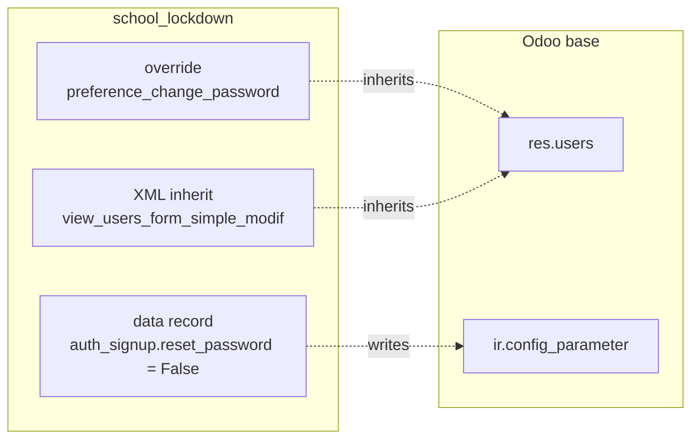

# `school_lockdown` — Entity Relationship Diagram

`school_lockdown` is a **behaviour-only** module: it defines no new models, no new fields on existing models, and no new relations. There is therefore nothing to draw in an ER diagram.

For completeness, here is what the module *touches*:

If a future change adds models or fields to this module, replace the flowchart above with a real `erDiagram` block matching the convention used by the other `docs/guide/<module>-erd.md` files.
